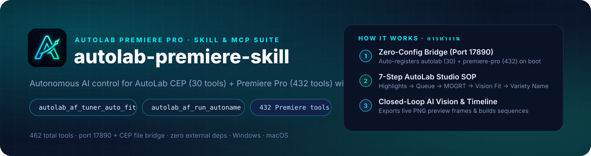
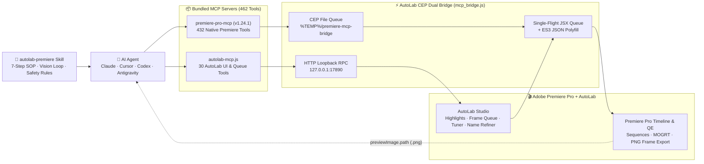

<div align="center">



**Give your AI agent full hands-on mastery over Adobe Premiere Pro & AutoLab — 30 AutoLab Studio workflow tools, 432 native Premiere Pro tools, closed-loop AI Vision framing, and zero-config local bridge discovery.**

**ติดมือและสมองให้เอเจนต์ AI ควบคุม Adobe Premiere Pro และ AutoLab แบบไร้คนคุม 100% — ครบทั้ง 30 เครื่องมือคุมหน้าจอ AutoLab, 432 เครื่องมือคุมไทม์ไลน์ Premiere Pro, ระบบจัดกรอบตรวจภาพจริงด้วย AI Vision, และสะพานเชื่อมอัตโนมัติแบบไม่ต้องตั้งค่า**

[](https://babydunx1.github.io/AutoLab-Release/)
[](#)
[-00C2FF.svg)](#tool-catalog--สารบัญเครื่องมือทั้งหมด-462-คำสั่ง)
[](skills/autolab-premiere/references/05-premiere-pro-432-tools-catalog.md)
[](skills/autolab-premiere/references/01-connection-and-bridge.md)
[](skills/autolab-premiere/SKILL.md)
[](LICENSE)
[](#installation)

> 🎬 **Official Companion Skill for [AutoLab — The Ultimate Editing Assistant for Premiere Pro](https://babydunx1.github.io/AutoLab-Release/)**  
> คู่มือสกิลและชุดคำสั่ง MCP อย่างเป็นทางการสำหรับทำงานร่วมกับโปรแกรม **[AutoLab — ผู้ช่วยตัดต่ออัจฉริยะสำหรับ Adobe Premiere Pro](https://babydunx1.github.io/AutoLab-Release/)**

**English** · [ภาษาไทย](#-ภาษาไทย) · [🌐 ดาวน์โหลดโปรแกรม AutoLab (Official Website)](https://babydunx1.github.io/AutoLab-Release/)

</div>

---

<div align="center">

### Architecture at a glance · ภาพรวมสถาปัตยกรรม



</div>

---

<div align="center">

### Install in 10 seconds · ติดตั้งใน 10 วินาที

```bash
# Install the official control skill (Claude Code / Codex / Cursor / Antigravity / Gemini CLI / OpenCode)
npx skills add https://github.com/Qtpx0/autolab-premiere-skill --skill autolab-premiere
```

```text
  ✓ Installed skill: autolab-premiere
    ├─ SKILL.md                                (Core 7-Step SOP & 5 Safety Rules)
    ├─ references/01-connection-and-bridge.md  (Port 17890 & CEP File Bridge)
    ├─ references/02-autolab-30-tools-reference.md     (All 30 AutoLab Tools)
    ├─ references/03-auto-frame-and-vision-sop.md      (Vision Framing & Variety Naming)
    ├─ references/04-auto-highlights-and-jumpcut-sop.md (Auto Highlights & Jump Cut)
    └─ references/05-premiere-pro-432-tools-catalog.md (All 432 Premiere Pro Tools)
```

Or inside **Adobe Premiere Pro → AutoLab → `🔌 API & MCP`**, click **`📋 สำเนาส่งให้ AI`** and paste directly into your AI chat.
หรือเปิดหน้าต่าง **AutoLab → `🔌 API & MCP`** ใน Premiere Pro แล้วกดปุ่ม **`📋 สำเนาส่งให้ AI`** ไปวางในแชท AI ได้ทันที

</div>

---

## 🇹🇭 ภาษาไทย

### ทำไมต้องมีสกิลและคู่มือชุดนี้?

ลำพังการเชื่อมต่อ MCP ทั้ง **462 เครื่องมือ** (`30 AutoLab Tools` + `432 Premiere Pro Tools`) เข้ากับเอเจนต์ AI เปล่าๆ โดยไม่มี **คู่มือควบคุมมาตรฐาน (`autolab-premiere`)** คอยกำกับ เอเจนต์จะเจอปัญหาใหญ่ 4 ข้อทันที:

1. **หยิบเครื่องมือผิดหมวด (Tool Confusion):** เมื่อสั่งให้ *"นำคลิปในโฟลเดอร์มาใส่กรอบทำคลิปสั้น"* เอเจนต์ที่ไม่รู้จัก AutoLab จะไปหยิบเครื่องมือดิบของ Premiere Pro (`create_sequence`, `place_clip`, `import_mogrt`) มานั่งสร้างเองทีละอันจนพัง แทนที่จะใช้ระบบคิวอัตโนมัติของ AutoLab (`autolab_af_queue_add` ➔ `autolab_af_set_bin_template` ➔ `autolab_af_start_queue`)
2. **จัดกรอบแบบเดาสุ่มตาบอด (Blind Framing):** ภาพยนตร์และรายการแต่ละเรื่องมีสัดส่วนภาพและขอบดำบน/ล่าง (Letterbox) ไม่เท่ากัน หากเอเจนต์เดาตัวเลข `Scale` / `PosY` โดยไม่รัน `autolab_af_tuner_auto_fit` และไม่เปิดดูภาพ PNG จริงที่แคปจากหน้าจอ `_AutoLab_Preview_` คลิปที่ได้จะมีขอบดำโผล่หรือกรอบพาดหัวทับหน้าตัวละคร
3. **ตั้งชื่อผิดโหมดและชื่อยาวล้นกรอบ (Naming & Overflow Errors):** เอเจนต์อาจเผลอใช้โหมดตั้งชื่อข่าว (`news`) กับงานหนัง/ละคร หรือปล่อยชื่อพาดหัวที่ยาวเกิน **17 ตัวอักษรไทย (`FILTER_CAP = 17`)** โดยไม่กดเรียก `💬 Name Refiner` ➔ `✂️ ย่อชื่อที่ยาว` (`autolab_af_run_name_refiner`) ทำให้ตัวหนังสือล้นออกนอกกรอบ `.mogrt`
4. **เผลอเปิด AutoCut ในงานตัดไฮไลท์หนัง:** ทำให้จังหวะดนตรีและอารมณ์ของฉากภาพยนตร์ถูกตัดแหว่งเสียหาย (งานหนังต้องตั้ง `autoCutState: 0` เสมอ)

`autolab-premiere-skill` จึงทำหน้าที่เป็น **"สมองและคู่มือปฏิบัติการมาตรฐาน"** ที่สอนให้เอเจนต์ AI รู้จักลำดับขั้นตอนที่ถูกต้องครบทั้ง 462 เครื่องมือ และสามารถอัปเดตคู่มือผ่าน GitHub ได้ตลอดเวลาโดยไม่ต้องออกไฟล์ติดตั้ง `AutoLab_Setup.exe` ใหม่

---

### จุดเด่นและความสามารถหลัก (Features)

| | ฟีเจอร์ | รายละเอียดการทำงาน |
| :---: | :--- | :--- |
| 🔌 | **หน้าต่าง `API & MCP` ในตัวโปรแกรม** | กดปุ่ม `🔌 API & MCP` บนแถบด้านบนของ AutoLab เพื่อดูสถานะพอร์ต `17890`, กดผูก MCP เข้า AI อัตโนมัติในคลิกเดียว, หรือก๊อปปี้คำสั่งติดตั้ง Skill ส่งให้ AI ได้ทันที (เหมือนหน้า API & MCP ของ AdsPower) |
| 🎬 | **`autolab` MCP (ครบ 30 Tools)** | ควบคุมทุกโมดูลของ AutoLab โดยตรง: **Auto Highlights**, **Auto Frame Queue**, การผูกกรอบ `.mogrt` & ป้ายโปรโมทแยกตาม Bin, **Live Frame Tuner (`🎯 จัดกรอบ`)**, **AI Auto-Name (`🎭 Variety`)**, **Name Refiner (`✂️ ย่อชื่อที่ยาว`)**, พาดหัว 1-2 บรรทัด และการกด **START** |
| 🛠️ | **`premiere-pro` MCP (ครบ 432 Tools · `v1.24.1`)** | ควบคุม Adobe Premiere Pro เชิงลึกครบทุกมิติ: สำรวจ Bin/ฟุตเทจ, จัดการ Sequence/Track, ตัดต่อคลิป, ปรับขนาด/ตำแหน่ง, ใส่เอฟเฟกต์/สี Lumetri, มิกซ์เสียง/คีย์เฟรม, มาร์กเกอร์/ซับไตเติล และส่งออกเรนเดอร์ผ่าน Media Encoder |
| 👁️ | **Closed-Loop AI Vision Framing (`🎯 จัดกรอบ`)** | วัดขอบดำอัตโนมัติด้วย FFmpeg `cropdetect` + สร้างซีเควนซ์จำลอง `_AutoLab_Preview_` ใน Premiere Pro พร้อมส่งออกภาพ `.png` จริงให้ AI เปิดดูด้วยตาเปล่าก่อนกดยืนยัน |
| 🪶 | **แยกไฟล์คู่มือแบบ Modular (ประหยัด Token)** | เอเจนต์อ่านเฉพาะ `SKILL.md` เพื่อเข้าใจภาพรวมและกฎเหล็ก แล้วค่อยเปิดอ่านไฟล์อ้างอิงเฉพาะหมวดใน `references/01..05` ตามงานที่ได้รับมอบหมาย |
| 🛡️ | **มัดรวมใน `AutoLab_Setup.exe` (Zero Dependencies)** | เซิร์ฟเวอร์ MCP ทั้งสองตัวถูกคอมไพล์รวมอยู่ใน `AutoLab/mcp/` เรียบร้อยแล้ว ไม่ต้องรัน `npm install` หรือพึ่งพา `node_modules` บนเครื่องพนักงาน |

---

### วิธีติดตั้งและใช้งาน (Installation)

<details open>
<summary><b>วิธีที่ A — ก๊อปปี้จากหน้าต่าง <code>🔌 API & MCP</code> ในโปรแกรม AutoLab ส่งให้ AI (แนะนำ, ~10 วินาที)</b></summary>

1. เปิดโปรแกรม **Adobe Premiere Pro** ➔ ไปที่เมนู **Window > Extensions > AutoLab**
2. คลิกปุ่ม **`🔌 API & MCP`** บนแถบด้านบนของหน้าแรก AutoLab
3. กดปุ่ม **`⚡ ผูกเข้า AI ในเครื่องอัตโนมัติ`** (หากเพิ่งกดครั้งแรก ให้ปิดและเปิดโปรแกรม AI ของคุณใหม่ 1 รอบ)
4. ในหัวข้อด้านล่างสุด กดปุ่ม **`📋 สำเนาส่งให้ AI`** แล้วนำไปวางในช่องแชทของเอเจนต์ AI ได้เลย:

```text
ติดตั้งและอ่านคู่มือควบคุม AutoLab Premiere Pro ด้วยคำสั่ง:
npx skills add https://github.com/Qtpx0/autolab-premiere-skill --skill autolab-premiere --force
(หรืออ่านคู่มือจาก https://github.com/Qtpx0/autolab-premiere-skill)
จากนั้นเช็คสถานะการเชื่อมต่อด้วยเครื่องมือ autolab_get_status และ get_project_info
```

</details>

<details open>
<summary><b>วิธีที่ B — ติดตั้ง Skill ผ่านคำสั่ง Terminal (รองรับทุก AI Agent)</b></summary>

เลือกคำสั่งตามโปรแกรม AI ที่คุณใช้งาน:

**สำหรับ Claude Code / Codex / Cursor / Antigravity / Gemini CLI / OpenCode:**
```bash
npx skills add https://github.com/Qtpx0/autolab-premiere-skill --skill autolab-premiere
```

**สำหรับ OpenClaw:**
```bash
npx clawhub@latest install Qtpx0/autolab-premiere-skill --force
```

**สำหรับ Hermes Agent:**
```bash
hermes skills install https://github.com/Qtpx0/autolab-premiere-skill/blob/main/skills/autolab-premiere --force
```

**สำหรับโคลนเก็บไว้ในเครื่องโดยตรง (Git Clone):**
```bash
git clone https://github.com/Qtpx0/autolab-premiere-skill.git
```

#### 🔁 วิธีอัปเดตเมื่อมีการปรับปรุงคู่มือ Skill ใหม่
ไม่ต้องติดตั้ง `AutoLab_Setup.exe` ใหม่! เพียงรันคำสั่งเดิมซ้ำ หรือพิมพ์บอกเอเจนต์ AI ของคุณว่า:
> *"อัปเดตสกิล `autolab-premiere` จาก `https://github.com/Qtpx0/autolab-premiere-skill` ให้เป็นเวอร์ชันล่าสุด"*

</details>

<details>
<summary><b>วิธีที่ C — การตั้งค่า MCP Server แบบ Manual (JSON & CLI สำหรับเครื่องที่ต้องการตั้งค่าเอง)</b></summary>

เมื่อติดตั้งผ่าน `AutoLab_Setup.exe` ไฟล์เซิร์ฟเวอร์ MCP ทั้งสองตัวจะอยู่ที่ `C:\Program Files (x86)\Common Files\Adobe\CEP\extensions\AutoLab\mcp\`

**1. การตั้งค่าทั่วไปแบบ JSON (Cursor / Claude Desktop / Windsurf / Antigravity):**
```json
{
  "mcpServers": {
    "autolab": {
      "command": "node",
      "args": [
        "C:\\Program Files (x86)\\Common Files\\Adobe\\CEP\\extensions\\AutoLab\\mcp\\autolab-mcp.js"
      ]
    },
    "premiere-pro": {
      "command": "node",
      "args": [
        "C:\\Program Files (x86)\\Common Files\\Adobe\\CEP\\extensions\\AutoLab\\mcp\\premiere-pro-mcp\\runtime\\index.js"
      ],
      "env": {
        "PREMIERE_TEMP_DIR": "C:\\Users\\<ชื่อผู้ใช้_WINDOWS>\\AppData\\Local\\Temp\\premiere-mcp-bridge"
      }
    }
  }
}
```

**2. การตั้งค่าผ่าน CLI สำหรับ Claude Code:**
```powershell
claude mcp add autolab -- node "C:\Program Files (x86)\Common Files\Adobe\CEP\extensions\AutoLab\mcp\autolab-mcp.js"
claude mcp add premiere-pro -e PREMIERE_TEMP_DIR="$env:TEMP\premiere-mcp-bridge" -- node "C:\Program Files (x86)\Common Files\Adobe\CEP\extensions\AutoLab\mcp\premiere-pro-mcp\runtime\index.js"
```

**3. การตั้งค่าผ่าน CLI สำหรับ Codex CLI:**
```powershell
codex mcp add autolab -- node "C:\Program Files (x86)\Common Files\Adobe\CEP\extensions\AutoLab\mcp\autolab-mcp.js"
codex mcp add --env PREMIERE_TEMP_DIR="$env:TEMP\premiere-mcp-bridge" premiere-pro -- node "C:\Program Files (x86)\Common Files\Adobe\CEP\extensions\AutoLab\mcp\premiere-pro-mcp\runtime\index.js"
```

📖 **ดูคู่มือการติดตั้งและตรวจสอบทีละขั้นตอนฉบับเต็มได้ที่: [docs/INSTALL.md](docs/INSTALL.md)**

</details>

<details>
<summary><b>วิธีที่ D — การสั่งงานผ่าน CLI โดยตรงโดยไม่ต้องผ่าน MCP (Direct CLI Mode)</b></summary>

ตัวไฟล์ `autolab-mcp.js` รองรับการรันเป็น CLI ได้ในตัวทันทีโดยไม่ต้องติดตั้งแพ็กเกจใดๆ เพิ่ม:

```powershell
# ตรวจสอบสถานะพาเนล AutoLab และพอร์ต 17890
node "C:\Program Files (x86)\Common Files\Adobe\CEP\extensions\AutoLab\mcp\autolab-mcp.js" --status

# แสดงรายการคำสั่ง AutoLab ทั้ง 30 คำสั่ง
node "C:\Program Files (x86)\Common Files\Adobe\CEP\extensions\AutoLab\mcp\autolab-mcp.js" --list-tools

# เรียกใช้คำสั่งใดๆ พร้อมพารามิเตอร์ JSON
node "C:\Program Files (x86)\Common Files\Adobe\CEP\extensions\AutoLab\mcp\autolab-mcp.js" --call autolab_af_queue_inspect "{}"
```

</details>

---

### ลำดับขั้นตอนการควบคุมมาตรฐาน 7 สเต็ป (7-Step Autonomous SOP)

| สเต็ป | ขั้นตอนการทำงาน | เครื่องมือที่ใช้ (MCP Tools) | กฎสำคัญที่ต้องระวัง |
| :---: | :--- | :--- | :--- |
| **1** | **สำรวจโปรเจกต์และ Bin ใน Premiere Pro** | `autolab_get_status`<br>`get_project_info`<br>`list_project_items` | เช็คให้แน่ใจว่าเปิดโปรเจกต์ `.prproj` และเปิดหน้าต่าง AutoLab แล้ว |
| **2** | **ตัดไฮไลท์หนังอัตโนมัติ (Auto Highlights)** | `autolab_ah_configure`<br>`autolab_ah_queue_add`<br>`autolab_ah_run` | ตั้ง `engineMode: "hybrid"`, `contentMode: "movie"` (ข้ามไปสเต็ป 3 ได้ถ้าตัดคลิปไว้ใน Bin แล้ว) |
| **3** | **โหลดคลิปเข้าคิว Auto Frame & เลือกกรอบ `.mogrt`** | `autolab_list_templates`<br>`autolab_af_queue_add`<br>`autolab_af_set_bin_template` | ผูกกรอบ (`frame`) และป้ายโปรโมท (`promo`) แยกตามแต่ละ `binKey` |
| **4** | **กด `🎯 จัดกรอบ` + ตรวจภาพจริงด้วย AI Vision** | `autolab_af_tuner_auto_fit`<br>`autolab_af_tuner_adjust`<br>`autolab_af_tuner_apply` | **ต้องเปิดดูไฟล์ภาพ `.png` (`previewImage.path`)** เพื่อเช็คขอบดำและศีรษะตัวละครก่อนกด Apply เสมอ |
| **5** | **กด `✨ AI Auto-Name` ตั้งชื่อคลิปไวรัล** | `autolab_af_configure_naming`<br>`autolab_af_run_autoname` | **ต้องใช้โหมด `mode: "variety"` เสมอ** ห้ามใช้โหมด `news` สำหรับงานหนัง/ละคร |
| **6** | **กด `💬 Name Refiner` ➔ `✂️ ย่อชื่อที่ยาว`** | `autolab_af_run_name_refiner`<br>`autolab_af_set_clip_title` | ย่อชื่อที่เกิน **17 ตัวอักษรไทย** ไม่ให้ล้นกรอบ และตั้งพาดหัว 1 หรือ 2 บรรทัด (`line1`, `line2`) |
| **7** | **ตั้งค่า Topbar & กดปุ่ม `START` สร้างซีเควนซ์** | `autolab_af_configure_topbar`<br>`autolab_af_start_queue` | ตั้งขนาด `1080x1920`, เปิด `injectHeadline: true`, และ **ปิด `autoCutState: 0` เสมอ** |

---

<a id="tool-catalog--สารบัญเครื่องมือทั้งหมด-462-คำสั่ง"></a>

### สารบัญคู่มือและเครื่องมือทั้งหมด 462 คำสั่ง (Complete Documentation Structure)

```text
autolab-premiere-skill/
├── README.md                                                     หน้าปกและคู่มือภาพรวม (EN / TH)
├── docs/
│   └── INSTALL.md                                                คู่มือติดตั้งและตรวจสอบทีละขั้นตอน
└── skills/
    └── autolab-premiere/
        ├── SKILL.md                                              คู่มือหลักสำหรับ AI Agent (กฎเหล็ก 6 ข้อ + SOP 7 สเต็ป)
        └── references/
            ├── 01-connection-and-bridge.md                       สถาปัตยกรรมพอร์ต 17890, CEP Bridge, CLI Mode และการแก้ปัญหา
            ├── 02-autolab-30-tools-reference.md                  คู่มืออ้างอิง AutoLab MCP ครบทั้ง 30 คำสั่ง (พารามิเตอร์ + JSON)
            ├── 03-auto-frame-and-vision-sop.md                   คู่มือเชิงลึก Auto Frame, 🎯 จัดกรอบ Vision Loop และตั้งชื่อ AI
            ├── 04-auto-highlights-and-jumpcut-sop.md             คู่มือเชิงลึก Auto Highlights และการตัดช่องว่างเสียงเงียบ
            └── 05-premiere-pro-432-tools-catalog.md              แคตตาล็อก Adobe Premiere Pro MCP (v1.24.1) ครบทั้ง 432 คำสั่ง
```

| ไฟล์คู่มืออ้างอิง (Reference File) | จำนวนเครื่องมือ | เนื้อหาภายในเอกสาร |
| :--- | :---: | :--- |
| [**`SKILL.md`**](skills/autolab-premiere/SKILL.md) | ภาพรวมทั้งหมด | กฎเหล็ก 6 ข้อ, ตารางสรุป 30 AutoLab Tools, และขั้นตอนปฏิบัติการ 7 สเต็ป |
| [**`01-connection-and-bridge.md`**](skills/autolab-premiere/references/01-connection-and-bridge.md) | ระบบเชื่อมต่อ | กลไกพอร์ต `17890`, `%TEMP%\premiere-mcp-bridge`, ES3 JSON Polyfill, และ CLI Mode |
| [**`02-autolab-30-tools-reference.md`**](skills/autolab-premiere/references/02-autolab-30-tools-reference.md) | **30 Tools** | รายละเอียดพารามิเตอร์ทุกฟิลด์และตัวอย่าง JSON ของเครื่องมือ `autolab_*` ทั้ง 30 ตัวครบ 100% |
| [**`03-auto-frame-and-vision-sop.md`**](skills/autolab-premiere/references/03-auto-frame-and-vision-sop.md) | คู่มือ Auto Frame | ขั้นตอนการจัดคิวแยกตาม Bin, การวัดขอบดำ `cropdetect`, การตรวจภาพ PNG และการย่อชื่อไทย |
| [**`04-auto-highlights-and-jumpcut-sop.md`**](skills/autolab-premiere/references/04-auto-highlights-and-jumpcut-sop.md) | คู่มือ Highlights | การตั้งค่า `hybrid`/`transcript`, `movie`/`podcast`, และการส่งต่อ Sequence เข้า Auto Frame |
| [**`05-premiere-pro-432-tools-catalog.md`**](skills/autolab-premiere/references/05-premiere-pro-432-tools-catalog.md) | **432 Tools** | แคตตาล็อกเครื่องมือ `premiere-pro` (`v1.24.1`) ครบทั้ง 432 ตัว แยกตาม 8 หมวดหมู่พร้อม Schema ทุกตัว |

---

### แก้ปัญหาที่พบบ่อย (Troubleshooting)

| อาการที่พบ | สาเหตุ / วิธีแก้ไข |
| :--- | :--- |
| **`ECONNREFUSED 127.0.0.1:17890`** | ยังไม่ได้เปิดหน้าต่าง AutoLab ใน Premiere Pro ➔ ไปที่เมนู **Window > Extensions > AutoLab** พอร์ต `17890` จะเปิดทำงานทันที |
| **กดผูก MCP แล้วแต่ AI ยังไม่เห็นเครื่องมือ** | โปรแกรม AI (เช่น Claude Desktop, Cursor, Antigravity) จะโหลดรายการ MCP ตอนเปิดโปรแกรม ➔ ให้ **ปิดและเปิดโปรแกรม AI ใหม่ 1 ครั้ง** |
| **เครื่องมือ `premiere-pro` แจ้ง Timeout** | ตรวจสอบว่าเปิดไฟล์โปรเจกต์ `.prproj` ใน Premiere Pro แล้ว และค่า `PREMIERE_TEMP_DIR` ชี้ไปที่ `%TEMP%\premiere-mcp-bridge` |
| **พาดหัวภาษาไทยล้นกรอบ `.mogrt`** | รันคำสั่ง `autolab_af_run_name_refiner` (`✂️ ย่อชื่อที่ยาว`) เพื่อให้ชื่อทุกคลิปมีความยาวไม่เกิน 17 ตัวอักษรไทย หรือแบ่งเป็น 2 บรรทัด (`line1`, `line2`) ด้วย `autolab_af_set_clip_title` |

---

## 🇬🇧 English

### Why this exists

Connecting **462 raw MCP tools** (`30 AutoLab tools` + `432 Premiere Pro tools`) to an AI agent without an operational skill results in four predictable failure modes:

1. **Reinventing AutoLab queues with raw timeline calls:** Without guidance, an agent asked to *"frame the clips in this bin"* will call raw Premiere Pro tools (`create_sequence`, `place_clip`, `import_mogrt`) one by one instead of driving AutoLab's batch queue (`autolab_af_queue_add` → `autolab_af_set_bin_template` → `autolab_af_start_queue`).
2. **Blind framing without visual inspection:** Different movies and shows have different aspect ratios and letterbox bars. Guessing `Scale` and `PosY` blindly leaves black bars or crops off actors' heads. `autolab-premiere` enforces a closed-loop Vision workflow via `autolab_af_tuner_auto_fit` (FFmpeg `cropdetect` + live `_AutoLab_Preview_` PNG frame export).
3. **Wrong naming mode & overflowing Thai headlines:** Entertainment clips require `mode: "variety"` (never `"news"`), and headlines exceeding **17 Thai visual characters (`FILTER_CAP = 17`)** must be refined via `autolab_af_run_name_refiner` (`✂️ ย่อชื่อที่ยาว` + `✅ Apply All`).
4. **Accidental Jump-Cut on movies:** `AutoCut` must always be kept off (`autoCutState: 0`) for movie/drama highlights so dramatic pacing and background score remain intact.

### Quick Start (English)

1. **Install the skill:**
   ```bash
   npx skills add https://github.com/Qtpx0/autolab-premiere-skill --skill autolab-premiere
   ```
2. **Open AutoLab inside Adobe Premiere Pro:**
   Go to **Window → Extensions → AutoLab**, click **`🔌 API & MCP`** on the top header, and click **`⚡ Auto-Connect`** (or copy the JSON/CLI snippet).
3. **Read the full guides:**
   - [Step-by-Step Installation (`docs/INSTALL.md`)](docs/INSTALL.md)
   - [Core Skill Rules & 7-Step SOP (`skills/autolab-premiere/SKILL.md`)](skills/autolab-premiere/SKILL.md)
   - [Complete 30 AutoLab Tools Reference (`02-autolab-30-tools-reference.md`)](skills/autolab-premiere/references/02-autolab-30-tools-reference.md)
   - [Complete 432 Premiere Pro Tools Catalog (`05-premiere-pro-432-tools-catalog.md`)](skills/autolab-premiere/references/05-premiere-pro-432-tools-catalog.md)

---

## 🤝 Acknowledgments & Open-Source Attribution · กิตติกรรมประกาศและแหล่งอ้างอิง

- 🎬 **[AutoLab — The Ultimate Editing Assistant for Premiere Pro](https://babydunx1.github.io/AutoLab-Release/)**: สกิลชุดนี้ออกแบบมาเพื่อทำงานร่วมกับส่วนเสริม **AutoLab CEP Extension** (`Port 17890` HTTP RPC + Unified CEP Bridge + 30 `autolab_*` workflow tools) สามารถดาวน์โหลดตัวติดตั้งและดูรายละเอียดโปรแกรมหลักได้ที่ [babydunx1.github.io/AutoLab-Release](https://babydunx1.github.io/AutoLab-Release/)
- 🛠️ **Native Premiere Pro MCP Engine (`v1.24.1` · 432 Tools)**: ส่วนขยายคำสั่งควบคุม Premiere Pro พื้นฐานทั้ง 432 คำสั่ง พัฒนาต่อยอดและปรับปรุงระบบ Unified Windows CEP Bridge จากโปรเจกต์โอเพนซอร์สภายใต้สัญญาอนุญาต MIT ([`leancoderkavy/premiere-pro-mcp`](https://github.com/leancoderkavy/premiere-pro-mcp) และ [`hetpatel-11/Adobe_Premiere_Pro_MCP`](https://github.com/hetpatel-11/Adobe_Premiere_Pro_MCP)) ขอขอบคุณทีมผู้พัฒนาต้นทางทุกท่าน

---

## 📄 License · สัญญาอนุญาต

MIT License — see [LICENSE](LICENSE).  
สัญญาอนุญาต MIT — ดูรายละเอียดในไฟล์ [LICENSE](LICENSE)

