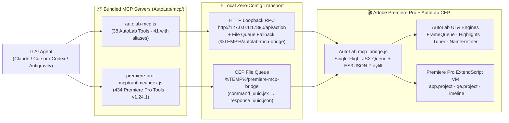
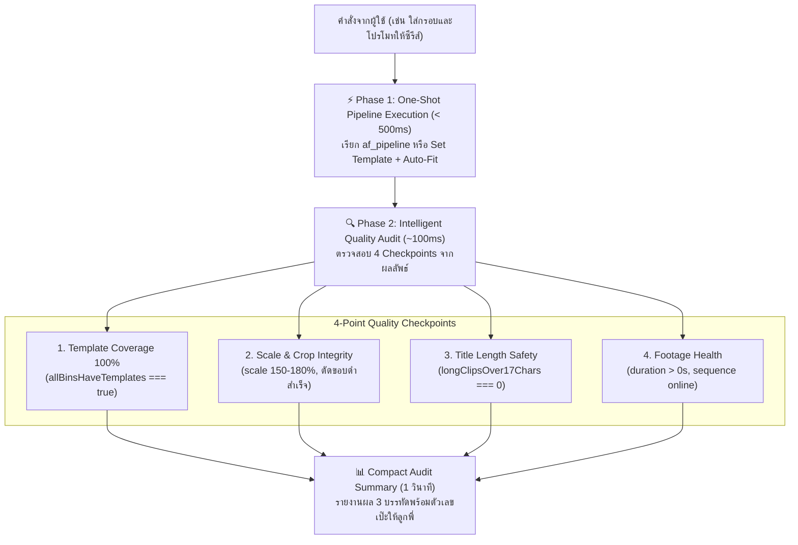

# 01 — Dual-Bridge Architecture, Discovery & CLI Guide
# สถาปัตยกรรมสะพานเชื่อมคู่ขนาน การค้นหาพอร์ตอัตโนมัติ และการใช้งานผ่าน CLI

เอกสารนี้อธิบายกลไกการทำงานของระบบสะพานเชื่อมคู่ขนาน (**Dual-Engine Local Bridge**) ที่ฝังอยู่ในโปรแกรม **AutoLab CEP Extension** (`AutoLab/js/core/mcp_bridge.js`) รวมถึงวิธีตรวจสอบสถานะ การเรียกใช้งานผ่าน CLI โดยตรง และวิธีแก้ปัญหาเมื่อเกิดข้อผิดพลาด

---

## 1. ภาพรวมสถาปัตยกรรมสะพานเชื่อมคู่ขนาน (Dual-Engine Architecture)

เมื่อผู้ใช้เปิดหน้าต่าง **AutoLab** ใน Adobe Premiere Pro (`Window > Extensions > AutoLab`) โมดูล `js/core/mcp_bridge.js` จะเปิดสะพานเชื่อมท้องถิ่น 2 ระบบขึ้นพร้อมกันโดยอัตโนมัติ:



### 1.1 Engine A: AutoLab Loopback HTTP RPC (`http://127.0.0.1:17890`)
- **หน้าที่:** รับคำสั่งทั้ง **38 Tools (41 รวม Aliases)** จาก `AutoLab/mcp/autolab-mcp.js` เพื่อควบคุมหน้าจอ AutoLab UI, คิวงาน Auto Frame, Auto Highlights, Live Frame Tuner (`🎯 จัดกรอบ`), AI Auto-Name, Name Refiner (`✂️ ย่อชื่อที่ยาว`), และ 7 Native Bin Management Tools
- **กลไกค้นหาพอร์ตอัตโนมัติ (Zero-Config Port Discovery):**
  - พอร์ตเริ่มต้นคือ `17890` (หากพอร์ตชนจะขยับไป `17891..17895` อัตโนมัติ)
  - บันทึกข้อมูลพอร์ตและสถานะล่าสุดลงใน `%TEMP%\autolab-mcp-bridge\autolab-bridge-info.json` ทุกๆ 2 วินาที
  - มีระบบสำรอง (**Atomic File Queue Fallback**): หาก HTTP ถูกบล็อกโดย Firewall เครื่องลูกข่าย `autolab-mcp.js` จะสลับไปส่งคำสั่งผ่านไฟล์ `req_<id>.json` / `res_<id>.json` ใน `%TEMP%\autolab-mcp-bridge` อัตโนมัติโดยที่งานไม่สะดุด

### 1.2 Engine B: Premiere Pro ExtendScript File Bridge (`%TEMP%\premiere-mcp-bridge`)
- **หน้าที่:** รับคำสั่งทั้ง **434 Tools** จาก `AutoLab/mcp/premiere-pro-mcp/runtime/index.js` (`v1.24.1`)
- **กลไก Single-Flight Queue & ES3 Polyfill:**
  - `mcp_bridge.js` สแกนไฟล์ `command_<uuid>.jsx` ใน `%TEMP%\premiere-mcp-bridge` ทุกๆ 200ms
  - ฉีด **`JSON.stringify` polyfill สำหรับ ExtendScript ES3** เข้าไปก่อนรันทุกคำสั่ง (แก้ปัญหา ExtendScript ของ Premiere Pro ไม่มี `JSON.stringify` มาตรฐาน)
  - จัดคิวรันทีละคำสั่ง (**Single-Flight Serialization**) เพื่อป้องกันไม่ให้คำสั่งจาก AutoLab และ Premiere Pro MCP ชนกันใน ExtendScript VM

---

## 2. ตำแหน่งไฟล์มาตรฐานหลังติดตั้ง (Installed File Locations)

เมื่อติดตั้งโปรแกรมผ่าน **`AutoLab_Setup.exe`** ไฟล์ทั้งหมดจะอยู่ที่:

| ส่วนประกอบ (Component) | ตำแหน่งไฟล์บน Windows (Standard Installed Path) |
| :--- | :--- |
| **AutoLab MCP Server (38 Tools · 41 with aliases)** | `C:\Program Files (x86)\Common Files\Adobe\CEP\extensions\AutoLab\mcp\autolab-mcp.js` |
| **Premiere Pro MCP Server (434 Tools)** | `C:\Program Files (x86)\Common Files\Adobe\CEP\extensions\AutoLab\mcp\premiere-pro-mcp\runtime\index.js` |
| **AutoLab Bridge Info JSON** | `%TEMP%\autolab-mcp-bridge\autolab-bridge-info.json` |
| **Premiere Pro Bridge Directory** | `%TEMP%\premiere-mcp-bridge` |

*(สำหรับเครื่องนักพัฒนา สามารถเรียกจากโฟลเดอร์ `AutoLab\mcp\` ในโปรเจกต์ได้โดยตรง)*

---

## 3. การกำหนดค่า MCP Server สำหรับ AI ทุกแพลตฟอร์ม (Universal AI Client Setup Guide)

เพื่อให้ AI Agent ทุกค่าย (Antigravity, Cursor, Claude Desktop, Windsurf, Cline) มี Native Tools ในหัวโดยตรง เรียกทำงานได้ใน **10–100ms** โดยไม่ต้องสั่งผ่าน Terminal ให้เพิ่มบล็อกการตั้งค่านี้ลงในไฟล์คอนฟิกของ AI แต่ละค่าย:

### 3.1 JSON Configuration มาตรฐาน (ใช้เหมือนกันทุกแพลตฟอร์ม)

```json
{
  "mcpServers": {
    "autolab": {
      "command": "node",
      "args": [
        "C:\\Program Files (x86)\\Common Files\\Adobe\\CEP\\extensions\\AutoLab\\mcp\\autolab-mcp.js"
      ]
    },
    "premiere-pro": {
      "command": "node",
      "args": [
        "C:\\Program Files (x86)\\Common Files\\Adobe\\CEP\\extensions\\AutoLab\\mcp\\premiere-pro-mcp\\runtime\\index.js"
      ],
      "env": {
        "PREMIERE_TEMP_DIR": "C:\\Users\\<USER>\\AppData\\Local\\Temp\\premiere-mcp-bridge"
      }
    }
  }
}
```

### 3.2 ตำแหน่งไฟล์คอนฟิกของ AI แต่ละค่าย (Config File Locations)

| ค่าย AI (Platform) | ตำแหน่งไฟล์คอนฟิกบน Windows (Configuration File Path) |
| :--- | :--- |
| 🪐 **Google Antigravity** | `C:\Users\<USER>\.gemini\config\mcp_config.json` *(ยึดโฟลเดอร์ `config` เท่านั้น)* |
| 💻 **Cursor IDE** | `C:\Users\<USER>\.cursor\mcp.json` *(หรือไฟล์ `.cursor/mcp.json` ใน Workspace)* |
| 🧠 **Claude Desktop** | `C:\Users\<USER>\AppData\Roaming\Claude\claude_desktop_config.json` |
| 🏄 **Codeium Windsurf** | `C:\Users\<USER>\.codeium\windsurf\mcp_config.json` |
| 🧩 **VS Code (Cline / Roo Code)** | ตั้งค่าผ่านแถบ MCP Settings ใน Extension UI โดยป้อนคำสั่งและอาร์กิวเมนต์ตามตารางด้านบน |

> 💡 **หมายเหตุ:** ในหน้าต่าง AutoLab Premiere Pro ผู้ใช้สามารถคลิกปุ่ม **`⚡ ผูกเข้า AI ในเครื่องอัตโนมัติ`** เพียง 1 คลิก ระบบจะหยอดคอนฟิกลงไฟล์ของทุกค่ายข้างต้นให้ทันทีโดยอัตโนมัติ

### 3.3 การตั้งค่าสิทธิ์ให้ AI รันอัตโนมัติ 100% ไม่ต้องเด้งถามกวนใจ (Zero-Prompt Auto-Execution Setup)

หากโปรแกรม AI (เช่น Antigravity หรือ Cursor) เด้งหน้าต่างถามสิทธิ์ซ้ำซาก (*"Allow using this MCP tool?"*) ทุกขั้นตอน ทำให้เสียเวลาทำงาน สามารถตั้งค่าให้ระบบอนุมัติอัตโนมัติ 100% ถาวรได้ทันที:

* **Google Antigravity:**  
  เปิดไฟล์ `C:\Users\<USER>\.gemini\config\config.json` แล้วเพิ่มสิทธิ์ Wildcard ในส่วน `globalPermissionGrants`:
  ```json
  "globalPermissionGrants": {
    "allow": [
      "command(*)",
      "mcp(autolab/*)",
      "mcp(premiere-pro/*)"
    ]
  }
  ```
  *(หรือเมื่อมีหน้าต่างเด้งถาม ให้กดเลือกข้อ `4 Yes, and always allow` ระบบจะบันทึกให้อัตโนมัติทันที)*

* **Cursor IDE:**  
  เปิดการตั้งค่า **Cursor Settings > Features > MCP** และเปิดสถานะ **Always Allow** สำหรับ Server `autolab` และ `premiere-pro`

* **Anthropic Claude Desktop:**  
  Claude Desktop จะอนุญาตคำสั่ง MCP ท้องถิ่น (Local Stdio) ตามที่กำหนดในคอนฟิกโดยอัตโนมัติอยู่แล้ว

---

## 4. การใช้งานผ่าน CLI โดยตรงสำหรับ Terminal Agents (Codex, DSH, Terminal)

สำหรับเอเจนต์ที่ไม่มี Native MCP GUI สามารถสั่งงานผ่าน CLI ได้ตรงๆ โดยใช้ **`--arg key=value`** เพื่อป้องกันปัญหาอัญประกาศ (Double-quote escaping) ของ PowerShell บน Windows:

```powershell
# 1. แสดงวิธีใช้งานและตัวอย่างคำสั่งด่วน (5ms)
node "C:\Program Files (x86)\Common Files\Adobe\CEP\extensions\AutoLab\mcp\autolab-mcp.js" --help

# 2. ตรวจสอบสถานะการเชื่อมต่อและคิวงาน (Live Health & Queue)
node "C:\Program Files (x86)\Common Files\Adobe\CEP\extensions\AutoLab\mcp\autolab-mcp.js" --status

# 3. รันคำสั่ง Pipeline รวดเดียวจบ (One-Shot af_pipeline)
node "C:\Program Files (x86)\Common Files\Adobe\CEP\extensions\AutoLab\mcp\autolab-mcp.js" --call autolab_af_pipeline --arg binPath="Movies/Series_A/HIGHLIGHTS_Series_A" --arg frame="Frame_02.mogrt" --arg promo="Promo_BrandA.mogrt"

# 4. ตั้งค่าเทมเพลตและจัดกรอบสเกลอัตโนมัติ (Two-Command Chain)
node "C:\Program Files (x86)\Common Files\Adobe\CEP\extensions\AutoLab\mcp\autolab-mcp.js" --call autolab_af_set_bin_template --arg binKey=* --arg frame="Frame_02.mogrt" --arg promo="Promo_BrandA.mogrt"
node "C:\Program Files (x86)\Common Files\Adobe\CEP\extensions\AutoLab\mcp\autolab-mcp.js" --call autolab_af_tuner_auto_fit --arg binKey=* --arg apply=true
```

---

## 5. กฎการตรวจสอบคุณภาพอัจฉริยะ 4 จุด (4-Point Intelligent Quality Audit Protocol)

เอเจนต์ไม่ใช่สคริปต์ตาบอดที่ส่งคำสั่งแล้วไม่สนใจผลลัพธ์ แต่เป็นเอเจนต์ที่ต้องทำงานรวดเร็วและ **ตรวจสอบคุณภาพได้ 100% ในเวลา 1–2 วินาที**:



### รายละเอียด 4 Checkpoints ที่เอเจนต์ต้องตรวจสอบ:
1. **Template Coverage (ความครอบคลุม):** เช็คว่า `allBinsHaveTemplates === true` ทุกคลิปต้องมีกรอบและโปรโม ไม่มีคลิปตกหล่น
2. **Scale & Crop Integrity (สเกลและขอบดำ):** เช็คว่าค่า `scale` อยู่ในเกณฑ์ปกติของ Aperture (ปกติ `150%–180%`) ไม่ใช่ 0% หรือ 500% และตรวจว่าตัดขอบดำเสร็จสิ้น (`cropAnalysis.hasBlackBars`)
3. **Title Length Safety (ความปลอดภัยของชื่อ):** เช็คว่า `longClipsOver17Chars === 0` หากยังมีคลิปยาวเกิน 17 ตัวอักษร ให้รัน `autolab_af_run_name_refiner` ต่อทันทีเพื่อป้องกันชื่อล้นกรอบโปรโม
4. **Footage Health (ความสมบูรณ์ของไฟล์):** ตรวจว่าคลิปมี Duration สมบูรณ์ ไม่เป็นคลิปเสียหรือคลิป 0 วินาที

---

## 6. ตารางวินิจฉัยและแก้ไขปัญหา (Troubleshooting Matrix)

| อาการที่พบ (Symptom) | สาเหตุ (Root Cause) | วิธีแก้ไข (Resolution) |
| :--- | :--- | :--- |
| `ECONNREFUSED 127.0.0.1:17890` หรือ Bridge Timeout | ยังไม่ได้เปิดโปรแกรม Adobe Premiere Pro หรือยังไม่ได้เปิดพาเนล AutoLab | เปิด Premiere Pro แล้วไปที่เมนู **Window > Extensions > AutoLab** ทันทีที่หน้าต่าง AutoLab เปิดขึ้น พอร์ต `17890` จะทำงานอัตโนมัติ |
| `premiere-pro` MCP แจ้ง `No active sequence` | ในโปรเจกต์ Premiere Pro ยังไม่ได้ดับเบิลคลิกเปิด Sequence ขึ้นบน Timeline | ใช้เครื่องมือ `list_project_items` หรือ `set_active_sequence` เพื่อเปิด Sequence หรือรันผ่านคิว AutoLab ซึ่งสร้าง Sequence ให้อัตโนมัติ |
| `premiere-pro` MCP ค้างหรือรอผลนานเกิน 30 วินาที | โฟลเดอร์ `PREMIERE_TEMP_DIR` ไม่ตรงกับที่ `mcp_bridge.js` เฝ้าอยู่ | ตรวจสอบให้แน่ใจว่าตัวแปรสภาพแวดล้อม `PREMIERE_TEMP_DIR` ชี้ไปที่ `%TEMP%\premiere-mcp-bridge` (หรือปล่อยว่างเพื่อให้ใช้ค่าเริ่มต้นเดียวกัน) |
| กดปุ่ม `⚡ ผูกเข้า AI ในเครื่องอัตโนมัติ` แล้ว AI ยังไม่เห็นเครื่องมือ | โปรแกรม AI Client (เช่น Claude Desktop / Cursor) โหลดรายชื่อ MCP เฉพาะตอนเปิดโปรแกรม | ปิดและเปิดโปรแกรม AI Client ใหม่ 1 ครั้ง (Restart AI Client) เพื่อโหลดรายการ 462 Tools ล่าสุด |
