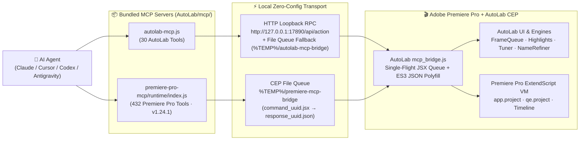

# 01 — Dual-Bridge Architecture, Discovery & CLI Guide
# สถาปัตยกรรมสะพานเชื่อมคู่ขนาน การค้นหาพอร์ตอัตโนมัติ และการใช้งานผ่าน CLI

เอกสารนี้อธิบายกลไกการทำงานของระบบสะพานเชื่อมคู่ขนาน (**Dual-Engine Local Bridge**) ที่ฝังอยู่ในโปรแกรม **AutoLab CEP Extension** (`AutoLab/js/core/mcp_bridge.js`) รวมถึงวิธีตรวจสอบสถานะ การเรียกใช้งานผ่าน CLI โดยตรง และวิธีแก้ปัญหาเมื่อเกิดข้อผิดพลาด

---

## 1. ภาพรวมสถาปัตยกรรมสะพานเชื่อมคู่ขนาน (Dual-Engine Architecture)

เมื่อผู้ใช้เปิดหน้าต่าง **AutoLab** ใน Adobe Premiere Pro (`Window > Extensions > AutoLab`) โมดูล `js/core/mcp_bridge.js` จะเปิดสะพานเชื่อมท้องถิ่น 2 ระบบขึ้นพร้อมกันโดยอัตโนมัติ:



### 1.1 Engine A: AutoLab Loopback HTTP RPC (`http://127.0.0.1:17890`)
- **หน้าที่:** รับคำสั่งทั้ง **30 Tools** จาก `AutoLab/mcp/autolab-mcp.js` เพื่อควบคุมหน้าจอ AutoLab UI, คิวงาน Auto Frame, Auto Highlights, Live Frame Tuner (`🎯 จัดกรอบ`), AI Auto-Name, และ Name Refiner (`✂️ ย่อชื่อที่ยาว`)
- **กลไกค้นหาพอร์ตอัตโนมัติ (Zero-Config Port Discovery):**
  - พอร์ตเริ่มต้นคือ `17890` (หากพอร์ตชนจะขยับไป `17891..17895` อัตโนมัติ)
  - บันทึกข้อมูลพอร์ตและสถานะล่าสุดลงใน `%TEMP%\autolab-mcp-bridge\autolab-bridge-info.json` ทุกๆ 2 วินาที
  - มีระบบสำรอง (**Atomic File Queue Fallback**): หาก HTTP ถูกบล็อกโดย Firewall เครื่องลูกข่าย `autolab-mcp.js` จะสลับไปส่งคำสั่งผ่านไฟล์ `req_<id>.json` / `res_<id>.json` ใน `%TEMP%\autolab-mcp-bridge` อัตโนมัติโดยที่งานไม่สะดุด

### 1.2 Engine B: Premiere Pro ExtendScript File Bridge (`%TEMP%\premiere-mcp-bridge`)
- **หน้าที่:** รับคำสั่งทั้ง **432 Tools** จาก `AutoLab/mcp/premiere-pro-mcp/runtime/index.js` (`v1.24.1`)
- **กลไก Single-Flight Queue & ES3 Polyfill:**
  - `mcp_bridge.js` สแกนไฟล์ `command_<uuid>.jsx` ใน `%TEMP%\premiere-mcp-bridge` ทุกๆ 200ms
  - ฉีด **`JSON.stringify` polyfill สำหรับ ExtendScript ES3** เข้าไปก่อนรันทุกคำสั่ง (แก้ปัญหา ExtendScript ของ Premiere Pro ไม่มี `JSON.stringify` มาตรฐาน)
  - จัดคิวรันทีละคำสั่ง (**Single-Flight Serialization**) เพื่อป้องกันไม่ให้คำสั่งจาก AutoLab และ Premiere Pro MCP ชนกันใน ExtendScript VM

---

## 2. ตำแหน่งไฟล์มาตรฐานหลังติดตั้ง (Installed File Locations)

เมื่อติดตั้งโปรแกรมผ่าน **`AutoLab_Setup.exe`** ไฟล์ทั้งหมดจะอยู่ที่:

| ส่วนประกอบ (Component) | ตำแหน่งไฟล์บน Windows (Standard Installed Path) |
| :--- | :--- |
| **AutoLab MCP Server (30 Tools)** | `C:\Program Files (x86)\Common Files\Adobe\CEP\extensions\AutoLab\mcp\autolab-mcp.js` |
| **Premiere Pro MCP Server (432 Tools)** | `C:\Program Files (x86)\Common Files\Adobe\CEP\extensions\AutoLab\mcp\premiere-pro-mcp\runtime\index.js` |
| **AutoLab Bridge Info JSON** | `%TEMP%\autolab-mcp-bridge\autolab-bridge-info.json` |
| **Premiere Pro Bridge Directory** | `%TEMP%\premiere-mcp-bridge` |

*(สำหรับเครื่องนักพัฒนา สามารถเรียกจากโฟลเดอร์ `AutoLab\mcp\` ในโปรเจกต์ได้โดยตรง)*

---

## 3. การใช้งานผ่าน CLI โดยตรง (Direct CLI Execution Mode)

นอกจากทำงานเป็น MCP Server แล้ว ไฟล์ `autolab-mcp.js` ยังเป็น **CLI Tool ในตัว** (ไม่ต้องพึ่งแพ็กเกจภายนอก) ทำให้เอเจนต์หรือสคริปต์สามารถสั่งงานผ่าน Terminal ได้ทันที:

```powershell
# 1. ตรวจสอบสถานะการเชื่อมต่อและข้อมูลคิวปัจจุบัน
node "C:\Program Files (x86)\Common Files\Adobe\CEP\extensions\AutoLab\mcp\autolab-mcp.js" --status

# 2. แสดงรายชื่อเครื่องมือทั้งหมด 30 คำสั่งพร้อมคำอธิบาย
node "C:\Program Files (x86)\Common Files\Adobe\CEP\extensions\AutoLab\mcp\autolab-mcp.js" --list-tools

# 3. เรียกใช้เครื่องมือใดๆ พร้อมส่งพารามิเตอร์ JSON
node "C:\Program Files (x86)\Common Files\Adobe\CEP\extensions\AutoLab\mcp\autolab-mcp.js" --call autolab_get_status "{}"
node "C:\Program Files (x86)\Common Files\Adobe\CEP\extensions\AutoLab\mcp\autolab-mcp.js" --call autolab_af_queue_inspect "{}"
```

หรือยิง HTTP Request ตรงไปที่พอร์ต `17890`:

```powershell
# ตรวจเช็ค Health Endpoint
curl http://127.0.0.1:17890/health

# ส่งคำสั่ง Action ผ่าน POST /api/action
curl -X POST http://127.0.0.1:17890/api/action -H "Content-Type: application/json" -d "{\"action\":\"status\",\"params\":{}}"
```

---

## 4. ตารางวินิจฉัยและแก้ไขปัญหา (Troubleshooting Matrix)

| อาการที่พบ (Symptom) | สาเหตุ (Root Cause) | วิธีแก้ไข (Resolution) |
| :--- | :--- | :--- |
| `ECONNREFUSED 127.0.0.1:17890` หรือ Bridge Timeout | ยังไม่ได้เปิดโปรแกรม Adobe Premiere Pro หรือยังไม่ได้เปิดพาเนล AutoLab | เปิด Premiere Pro แล้วไปที่เมนู **Window > Extensions > AutoLab** ทันทีที่หน้าต่าง AutoLab เปิดขึ้น พอร์ต `17890` จะทำงานอัตโนมัติ |
| `premiere-pro` MCP แจ้ง `No active sequence` | ในโปรเจกต์ Premiere Pro ยังไม่ได้ดับเบิลคลิกเปิด Sequence ขึ้นบน Timeline | ใช้เครื่องมือ `list_project_items` หรือ `set_active_sequence` เพื่อเปิด Sequence หรือรันผ่านคิว AutoLab ซึ่งสร้าง Sequence ให้อัตโนมัติ |
| `premiere-pro` MCP ค้างหรือรอผลนานเกิน 30 วินาที | โฟลเดอร์ `PREMIERE_TEMP_DIR` ไม่ตรงกับที่ `mcp_bridge.js` เฝ้าอยู่ | ตรวจสอบให้แน่ใจว่าตัวแปรสภาพแวดล้อม `PREMIERE_TEMP_DIR` ชี้ไปที่ `%TEMP%\premiere-mcp-bridge` (หรือปล่อยว่างเพื่อให้ใช้ค่าเริ่มต้นเดียวกัน) |
| กดปุ่ม `⚡ ผูกเข้า AI ในเครื่องอัตโนมัติ` แล้ว AI ยังไม่เห็นเครื่องมือ | โปรแกรม AI Client (เช่น Claude Desktop / Cursor) โหลดรายชื่อ MCP เฉพาะตอนเปิดโปรแกรม | ปิดและเปิดโปรแกรม AI Client ใหม่ 1 ครั้ง (Restart AI Client) เพื่อโหลดรายการ 462 Tools ล่าสุด |
