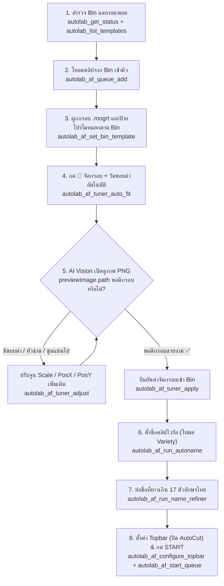

# 03 — Auto Frame Queue, Vision Framing (`🎯 จัดกรอบ`) & AI Naming SOP
# คู่มือปฏิบัติการเชิงลึก: ระบบคิว Auto Frame, การจัดกรอบด้วย AI Vision และการตั้งชื่อคลิปไวรัล

เอกสารนี้อธิบายขั้นตอนมาตรฐานในการควบคุมโมดูล **Auto Frame Studio** ของโปรแกรม AutoLab ตั้งแต่การดึงคลิปเข้าคิวแยกตามโฟลเดอร์ Bin, การเลือกกรอบ `.mogrt` และป้ายโปรโมท, การกด **`🎯 จัดกรอบ`** พร้อมตรวจภาพจริงด้วย AI Vision, การกด **`✨ AI Auto-Name`** (`Variety`), การกด **`💬 Name Refiner` ➔ `✂️ ย่อชื่อที่ยาว`**, ไปจนถึงการกด **`START`** เพื่อสร้างซีเควนซ์ทั้งหมด

---

## 1. แผนผังขั้นตอนการทำงาน (Auto Frame End-to-End Pipeline)



---

## 2. รายละเอียดแต่ละสเต็ปและกฎเหล็กที่ต้องปฏิบัติตาม

### Step 1: สำรวจเทมเพลตกรอบ `.mogrt` และป้ายโปรโมทที่มีในเครื่อง
ก่อนผูกกรอบให้แต่ละ Bin ให้เรียก `autolab_list_templates` เพื่อดูรายชื่อกรอบและป้ายโปรโมททั้งหมดที่มีในเครื่อง:
```json
// Tool: autolab_list_templates
{}
```
- หากต้องการซิงค์กรอบใหม่ล่าสุดของทีมจาก Cloud Storage ให้เรียก `autolab_sync_company_pack({ "force": false })`

### Step 2: ดึงคลิปหรือ Sequence จาก Premiere Pro Bin เข้าคิว
- หากตัดไฮไลท์มาจาก Auto Highlights แล้ว (เป็น Sequence ย่อยใน Bin) ให้ตั้ง `"onlySequences": true`
- หากเป็นไฟล์วิดีโอฟุตเทจใน Bin ให้ตั้ง `"onlyMediaClips": true` (หรือไม่ระบุเพื่อดึงทั้งหมด)
```json
// Tool: autolab_af_queue_add
{
  "binNames": ["เป็นต่อ", "สุภาพบุรุษสุดซอย"],
  "clearFirst": true
}
```
- เรียก `autolab_af_queue_inspect` เพื่อดูรายการ Bin (`binKey`, `binName`) และจำนวนคลิปที่ถูกโหลดเข้ามา

### Step 3: เลือกกรอบ `.mogrt` และป้ายโปรโมทแยกตาม Bin
แต่ละรายการหรือแต่ละเรื่องสามารถใช้กรอบ `.mogrt` และป้ายโปรโมทต่างกันได้ โดยระบุ `binKey`:
```json
// Tool: autolab_af_set_bin_template
{
  "binKey": "เป็นต่อ",
  "frame": "ชื่อไฟล์กรอบ.mogrt",
  "promo": "ชื่อไฟล์ป้ายโปรโมท.mogrt"
}
```
*(หากต้องการใช้กรอบเดียวกันทุก Bin ในคิว ให้ส่ง `"binKey": "*"`)*

### Step 4: กด `🎯 จัดกรอบ` (Live Frame Tuner) และตรวจสอบภาพจริงด้วย AI Vision
> **🚨 กฎเหล็ก:** ห้ามเดาตัวเลข `scale` หรือ `posY` โดยไม่ดูภาพจริงเด็ดขาด เพราะคลิปแต่ละเรื่องมีอัตราส่วนภาพและขอบดำ (Letterbox) ไม่เท่ากัน!

1. **สั่งคำนวณขนาดอัตโนมัติด้วย FFmpeg `cropdetect`:**
   ```json
   // Tool: autolab_af_tuner_auto_fit
   {
     "binKey": "เป็นต่อ",
     "targetWindowWidth": 1080
   }
   ```
   - คำสั่งนี้จะสร้างซีเควนซ์ชั่วคราว `_AutoLab_Preview_` ใน Premiere Pro ที่วางคลิปจริง + กรอบ `.mogrt` + ป้ายโปรโมท ซ้อนกันตามจริง แล้วเรนเดอร์เฟรมภาพออกมาเป็นไฟล์ PNG ที่ `previewImage.path`
2. **ใช้เครื่องมือดูภาพของ AI (เช่น `view_file`) เปิดดูไฟล์ `previewImage.path`:**
   - ตรวจสอบ 3 จุดสำคัญ:
     1) **ขอบดำบน/ล่าง:** ภาพวิดีโอขยายเต็มช่องว่างของกรอบ `.mogrt` หรือยัง? มีแถบสีดำโผล่ระหว่างภาพกับขอบกรอบหรือไม่?
     2) **ศีรษะและใบหน้าตัวละคร:** ตำแหน่ง `posY` สูงหรือต่ำเกินไปจนกรอบพาดหัวด้านบนทับหน้าตัวละครหรือไม่?
     3) **ความสมดุลซ้าย/ขวา (`posX`):** ตัวละครหลักอยู่กึ่งกลางเฟรม (`posX: 540`) พอดีหรือไม่?
3. **หากต้องขยับปรับแต่งเพิ่มเติม:**
   ```json
   // Tool: autolab_af_tuner_adjust
   {
     "scale": 145,
     "posX": 540,
     "posY": 990,
     "timeSeconds": 12
   }
   ```
   - แล้วเปิดดูภาพ PNG ใบใหม่ที่ส่งกลับมาจนกว่าจะพอดีเป๊ะ
4. **กดยืนยันค่าเข้า Bin:**
   ```json
   // Tool: autolab_af_tuner_apply
   {
     "binKey": "เป็นต่อ"
   }
   ```
   *(ระบบจะบันทึกค่า Scale/PosX/PosY ลงใน Bin นั้น และลบ `_AutoLab_Preview_` ออกจากโปรเจกต์ให้อัตโนมัติ)*

### Step 5: กด `✨ AI Auto-Name` (โหมด `🎭 Variety` เสมอสำหรับงานหนัง/ละคร)
> **🚨 กฎเหล็ก:** สำหรับงานตัดไฮไลท์หนัง ละคร ซีรีส์ หรือรายการวาไรตี้ **ต้องใช้ `mode: "variety"` เสมอ** ห้ามใช้ `mode: "news"` เด็ดขาด!

```json
// Tool: autolab_af_run_autoname
{
  "mode": "variety",
  "autoApply": true
}
```
- ระบบจะถอดเสียงพูดในคลิปด้วย Whisper ส่งให้ LLM คิดชื่อพาดหัวสไตล์ไวรัล และกดปุ่ม `✅ Apply All` นำชื่อใส่ลงในคิวให้อัตโนมัติ

### Step 6: กด `💬 Name Refiner` ➔ `✂️ ย่อชื่อที่ยาว` ➔ `✅ Apply All`
- ตัวอักษรภาษาไทยในกรอบ `.mogrt` จะสวยและไม่ล้นกรอบเมื่อความยาวตัวอักษรที่มองเห็นจริง (**Thai Visual Length** คือไม่นับสระบน/ล่างและวรรณยุกต์ `[\u0E31\u0E34-\u0E3A\u0E47-\u0E4E]`) **ไม่เกิน 17 ตัวอักษรต่อบรรทัด (`FILTER_CAP = 17`)**
- ให้รัน `autolab_af_run_name_refiner` เสมอหลังจากตั้งชื่อเสร็จ เพื่อคัดกรองคลิปที่ยาวเกิน 17 ตัวอักษรมาสั่งย่อให้กระชับและกด Apply All อัตโนมัติ:
```json
// Tool: autolab_af_run_name_refiner
{
  "instruction": "ย่อชื่อที่ยาวเกินให้สั้น",
  "autoApply": true,
  "closeModal": true
}
```
- **การตั้งชื่อแบบ 1 บรรทัด vs 2 บรรทัด (`+ เพิ่มบรรทัดที่ 2`):**
  - หากกรอบ `.mogrt` ที่ใช้เป็นแบบ **2 บรรทัด** สามารถใช้ `autolab_af_set_clip_title` ส่งทั้ง `line1` และ `line2` (บรรทัดละไม่เกิน 17 ตัวอักษรไทย) ได้ทันที:
    ```json
    // Tool: autolab_af_set_clip_title
    {
      "index": 0,
      "line1": "นึกว่าหมูในอวย",
      "line2": "ที่ไหนได้โคตรเทพ"
    }
    ```

### Step 7: ตั้งค่า Topbar และกดปุ่ม `START`
1. ตั้งค่าแถบด้านบน (`1080x1920`, เปิด `injectHeadline: true`, และ **ปิด AutoCut `autoCutState: 0`**):
   ```json
   // Tool: autolab_af_configure_topbar
   {
     "resMode": "custom",
     "width": 1080,
     "height": 1920,
     "promoStart": 5,
     "promoInterval": 0,
     "injectHeadline": true,
     "autoCutState": 0
   }
   ```
2. ตรวจสอบคิวครั้งสุดท้ายด้วย `autolab_af_queue_inspect` ว่า `allBinsHaveTemplates: true`
3. กดปุ่ม **`START`** เพื่อสร้างซีเควนซ์ทั้งหมดจนเสร็จ:
   ```json
   // Tool: autolab_af_start_queue
   {
     "wait": true,
     "autoDismissModal": true
   }
   ```
